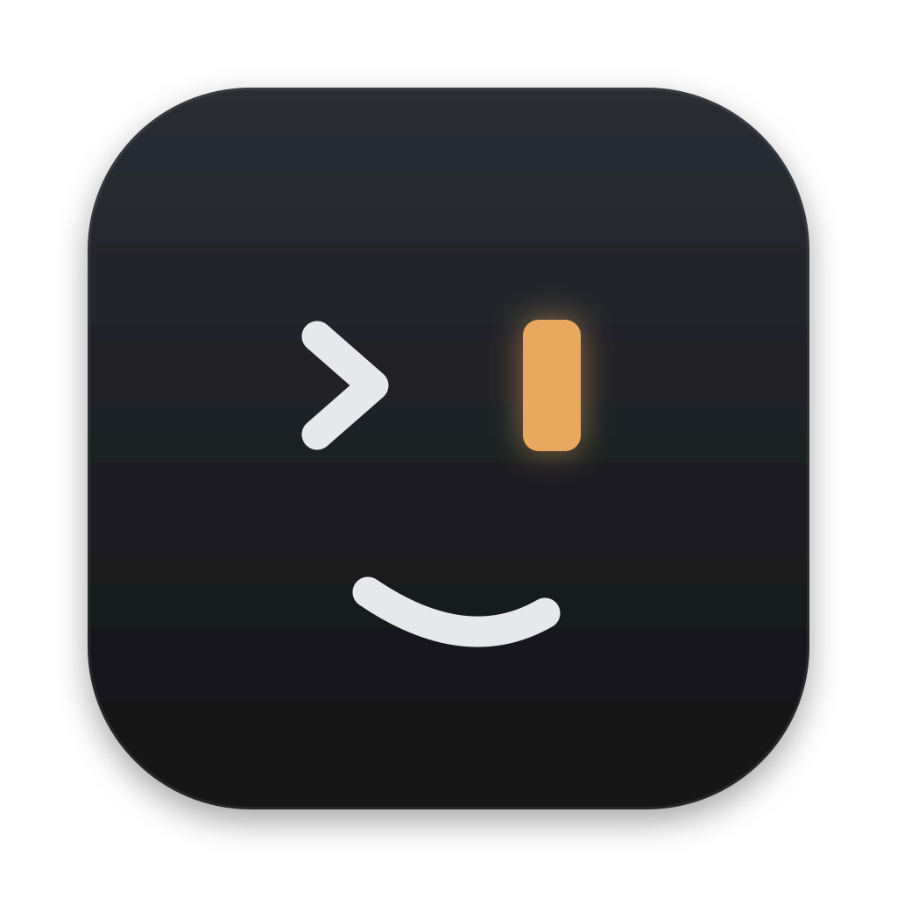
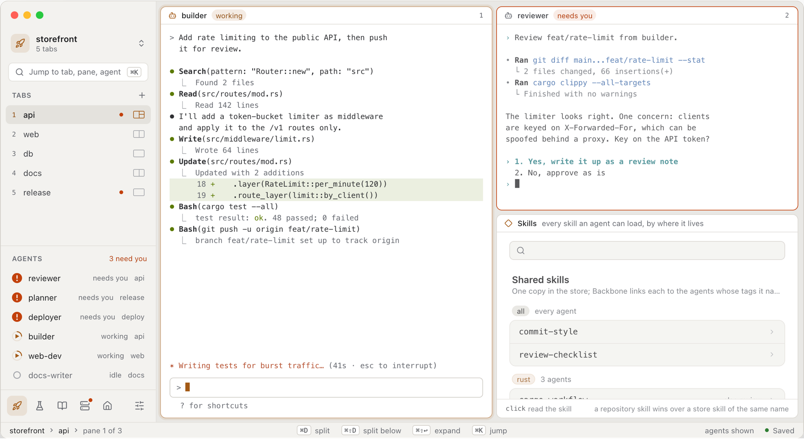
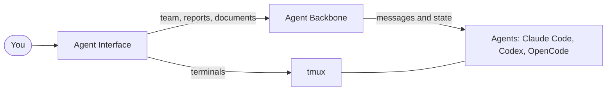

<div align="center">



# Agent Interface

**The native desktop for your agent team.**

Run Claude Code, Codex and OpenCode agents in real terminals, see at a glance
which one needs you, and read their reports and documents beside the work.

[](https://github.com/eandualem/agent-interface/releases)
[](https://github.com/eandualem/agent-interface/actions/workflows/ci.yml)
[](LICENSE)

[Website](https://agentinterface.dev) · [Install](#install) · [User guide](docs/GUIDE.md) · [Architecture](docs/ARCHITECTURE.md) · [Contribute](CONTRIBUTING.md)

</div>

<p align="center">
  <picture>
    <source media="(prefers-color-scheme: dark)" srcset="docs/media/workspace-dark.png">
    <source media="(prefers-color-scheme: light)" srcset="docs/media/workspace-light.png">
    
  </picture>
</p>
<p align="center"><em>Illustration with example data.</em></p>

## One system for agent work

Agent Interface and [Agent Backbone](https://github.com/eandualem/agent-backbone)
work together. Backbone turns agents across CLIs and projects into one team, with
names, safe messages, live state and continuity. Agent Interface is where you work
with that team.

- **Know who needs you.** Active agents show their state, such as working, idle
  or waiting on you. Click one to go to the tab that shows its session.
- **Real terminals.** Panes are drawn natively with GPUI and Ghostty's terminal
  core. tmux keeps every process running, and you can attach the sessions you
  already use.
- **The team beside the work.** Open Team, Activity, Usage, Skills, Policies and
  Tags views in a pane, next to the agents they describe.
- **Reports, answers and documents.** **Reports & updates** collects progress
  reports, saved answers and Documents. Reply to the author from the record you
  are reading.
- **Workspaces that come back.** Tabs and split panes are saved in workspaces.
  Jump (⌘K) finds tabs, panes, agents and commands.

Without Backbone, Agent Interface is still a native workspace for tmux.



## Install

You need macOS or Linux and tmux 3.3 or newer (`brew install tmux` on macOS).
On Linux, install the [runtime libraries](docs/INSTALL.md#runtime-prerequisites) first.

**1. Install Agent Interface and Agent Backbone.** The installer downloads the
compiled app from the [latest release](https://github.com/eandualem/agent-interface/releases),
checks its checksum, and installs the latest compatible published Backbone.
It supplies uv and Python when needed; no Rust or manual Python installation is required.

```sh
curl -fsSL https://raw.githubusercontent.com/eandualem/agent-interface/main/install.sh | sh
```

**2. Open Agent Interface.** Continue through native onboarding to choose an
installed, signed-in agent tool and create your first agent. Existing Backbone
configuration is preserved; see [connection guidance](docs/INSTALL.md#connect-agent-backbone)
if you manage that installation independently.

The [installation guide](docs/INSTALL.md) covers package architectures, manual
downloads, Windows 11 / WSL setup, updates and removal.

## Get started

1. Press **⌘T** (Ctrl+Shift+T on Linux), then choose **Open terminal** or pick a
   running tmux session to attach it.
2. Split the pane with **⌘D**, or **⌘⇧D** to split below (Ctrl+Shift+D and
   Ctrl+Shift+E on Linux).
3. In an empty pane, choose a view such as **Team** or **Reports & updates**.
4. Once an agent's session is in a tab, click the agent in the sidebar to go there.

The [user guide](docs/GUIDE.md) covers every view, shortcut and setting.

## Documentation

- [User guide](docs/GUIDE.md): workspaces, sessions, agent views, reports, shortcuts and libraries.
- [Installation](docs/INSTALL.md): packages, prerequisites, Backbone connection, updates and removal.
- [Architecture](docs/ARCHITECTURE.md): processes, crate boundaries, data flow and dependencies.
- [Design](docs/DESIGN.md): appearance, components and design tokens.
- [Benchmarks](docs/BENCHMARKING.md): repeatable measurements on isolated tmux servers.
- [Contributing](CONTRIBUTING.md): building from source, tests and pull requests.

## Status

Agent Interface runs on macOS and Linux (Wayland and X11). Windows 11 runs the
Linux package through WSL 2 with WSLg. Sessions run on the
same computer as the app. Rich HTML Documents render on macOS only.

Not yet implemented: terminal input methods, accessible terminal text, key-release
events and selection across history pages.

Agent Interface reimplements [tmux-workspaces](https://github.com/eandualem/tmux-workspaces)
in Rust and opens its saved schema-v2 libraries. It needs no Python runtime.

## Licence

MIT. See [LICENSE](LICENSE).
